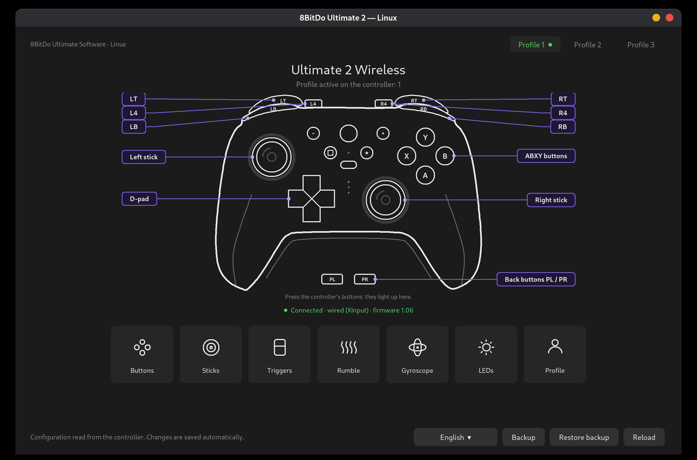
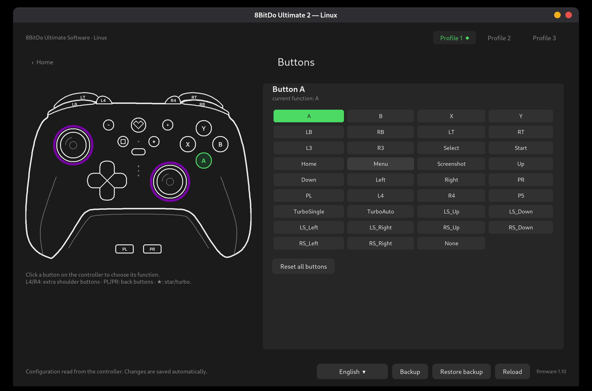
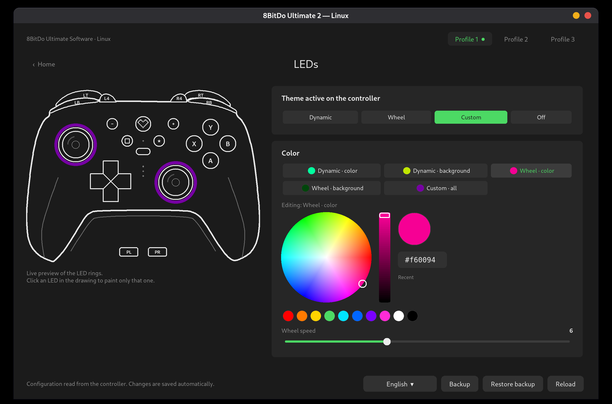

# ultimate2 — 8BitDo Ultimate 2 Wireless configurator for Linux

Open-source replacement for the configuration part of *8BitDo Ultimate Software V2*, which only exists
for Windows/macOS. It talks to the controller directly over `/dev/hidraw`. You get a command-line tool,
`u2ctl`, and a graphical interface, `u2gui`, styled after the official app.

*Português:* [veja o resumo em português](#português).



| Button remapping | LED rings and colour wheel |
|---|---|
|  |  |

> **Not affiliated with 8BitDo.** "8BitDo" and "Ultimate 2" are trademarks of their owner. The protocol was
> reverse-engineered for interoperability; no code or assets from the official software are included.

## Features

| | `u2ctl` | `u2gui` |
|---|:-:|:-:|
| Read firmware version, active profile, controller edition | ✓ | ✓ |
| 3 custom profiles: create, rename, enable/disable | ✓ | ✓ |
| Button remapping (incl. L4/R4 and the PL/PR back buttons) | ✓ | ✓ |
| Stick dead zones/range, invert axes, swap sticks/d-pad | ✓ | ✓ |
| Trigger ranges, swap triggers, trigger rumble | ✓ | ✓ |
| Rumble strength, gyro (6-axis) mapping | ✓ | ✓ |
| LED rings: active theme (dynamic / hotwheel / custom / off), colours, speed, per-LED colours | ✓ | ✓ |
| Backup / restore of the whole configuration | ✓ | ✓ |
| Live view of the buttons you press, sticks and triggers | | ✓ |
| Auto-save (changes are written ~0.4 s later and verified) | | ✓ |
| Interface in English or Brazilian Portuguese (system language, changeable) | | ✓ |

Tested with an Ultimate 2 Wireless (firmware 1.10) over USB (`2dc8:310b`). The 2.4G dongle (`2dc8:6013`) speaks
the same protocol once the controller is paired, but this has not been tested yet.

## Install

### Debian / Ubuntu (.deb) — recommended

Download `ultimate2_<version>_all.deb` from the
[Releases page](https://github.com/MiguelSanzBr/8bitdo-ultimate2-linux/releases), then:

```bash
sudo apt install ./ultimate2_0.1.0-beta5_all.deb
```

This installs the `u2ctl` and `u2gui` commands, the menu entry "8BitDo Ultimate 2" and the udev rule.
Unplug and replug the controller afterwards.

### Arch Linux (.pkg.tar.zst)

Download `8bitdo-ultimate2-<version>-any.pkg.tar.zst` from the
[Releases page](https://github.com/MiguelSanzBr/8bitdo-ultimate2-linux/releases), then:

```bash
sudo pacman -U ./8bitdo-ultimate2-0.1.0beta5-1-any.pkg.tar.zst
```

Or build it yourself from the [`PKGBUILD`](packaging/aur/PKGBUILD) (`makepkg -si` in `packaging/aur`). Replug the
controller afterwards.

### AppImage (any distribution)

Download `ultimate2-appimage.zip` from the [Releases page](https://github.com/MiguelSanzBr/8bitdo-ultimate2-linux/releases)
and extract it. It contains the AppImage, `install-udev.sh` and the udev rule. **The first time only**, install the
rule, because an AppImage cannot do it by itself:

```bash
chmod +x install-udev.sh 8BitDo-Ultimate-2-*.AppImage   # a zip download loses the executable bit
./install-udev.sh                                       # asks for your password
```

Then unplug and replug the controller (or its 2.4G adapter) and start the AppImage. Without the rule the app cannot
open the controller. If it refuses to start because FUSE is missing, run it with
`APPIMAGE_EXTRACT_AND_RUN=1 ./8BitDo-Ultimate-2-*.AppImage`.

### Flatpak

From the signed repository at <https://miguelsanzbr.github.io/flatpak/> (updates arrive with `flatpak update`):

```bash
flatpak remote-add --user --if-not-exists miguelsanz https://miguelsanzbr.github.io/flatpak/miguelsanz.flatpakrepo
flatpak install --user miguelsanz io.github.miguelsanzbr._8bitdo-ultimate2-linux
```

Each release also has a `.flatpak` file (`flatpak install --user ./file.flatpak`). The app is not on Flathub. Inside the sandbox the app reaches the device through its hidraw node, so
the udev rule is still installed once on the host, from a clone of this repository or with `install-udev.sh` from the AppImage zip:

```bash
sudo install -m644 udev/70-8bitdo-u2.rules /etc/udev/rules.d/ && sudo udevadm control --reload && sudo udevadm trigger --action=add --subsystem-match=hidraw
```

The AppStream metadata, desktop entry and icon for Flatpak are in `packaging/flatpak/`.

### From source

Requirements: Python ≥ 3.8 and Tk (`python3-tk` on Debian/Ubuntu) for the GUI. There are no other
dependencies.

```bash
git clone https://github.com/MiguelSanzBr/8bitdo-ultimate2-linux.git && cd 8bitdo-ultimate2-linux
sudo cp udev/70-8bitdo-u2.rules /etc/udev/rules.d/ && sudo udevadm control --reload && sudo udevadm trigger --action=add --subsystem-match=hidraw
pip install .            # installs the u2ctl and u2gui commands
```

You can also skip installing and run `./u2ctl.py` and `./u2gui.py` straight from the checkout.
Build the `.deb` yourself with `./packaging/build-deb.sh` (output in `dist/`).

> **Beta.** Make a backup first (`u2ctl backup orig.bin`, or the *Backup* button) so you can restore your
> controller's original configuration.

## Usage

### Graphical interface

```bash
u2gui
```

- **Home**: a drawing of your controller in its own colours (the edition is detected). Buttons light up when you
  press them, and the LED rings preview the current effect. The tiles open each section.
- **Profiles 1–3** are at the top. ● marks the profile the controller is currently using; switch profiles with the
  controller's profile button. A banner warns you when you edit a profile that is not active.
- **Buttons**: click a button on the drawing, then choose its new function.
- **LEDs**: pick the active theme, then click what to colour (theme colours, all custom LEDs, or a single LED on
  the drawing) and use the colour wheel.
- **Profile** page: besides the profile settings, it holds the **interface language** (English or Brazilian
  Portuguese). The first run follows the system language; picking another one (here or in the selector next to
  **Backup**) restarts the window in it.
- Changes are saved automatically. **Backup / Restaurar backup** save and restore the whole configuration.

### Command line

```bash
u2ctl list                       # detected devices
u2ctl info                       # firmware, mode, active slot
u2ctl backup orig.bin            # raw backup (do this first)
u2ctl new-slot 0 --name Meu      # make slot 0 a custom profile with the app's defaults
u2ctl dump -o cfg.json           # configuration as JSON
#  … edit cfg.json …
u2ctl apply cfg.json -n          # show what would change
u2ctl apply cfg.json             # write, save to flash, verify
u2ctl theme hotwheel             # active LED theme: dynamic | hotwheel | custom | off
u2ctl restore orig.bin           # undo everything
```

`apply` only writes the fields you changed; every other byte is kept exactly as read from the controller.

### JSON fields

There are three slots, `slots[0..2]`. A slot or section is only used when its `flag` is `"enabled"`; on a fresh
controller everything reads `0xffffffff` (erased flash). `u2ctl new-slot` fills a slot with sane defaults.

| Field | Meaning |
|---|---|
| `gamepad_mode` | 0 Switch, 1 Android, 3 Windows/XInput |
| `slots[n].flag` | `"enabled"` turns the slot into a custom profile |
| `name` | up to 16 characters |
| `mapping.<button>` | function of a physical button: `A B X Y LB RB LT RT L3 R3 Select Start Home Menu Screenshot Up Down Left Right P1..P5 TurboSingle TurboAuto LS_Up.. RS_Right None` (`P1` = PR and `P2` = PL, the back buttons; `P3` = L4 and `P4` = R4, the small shoulder buttons) |
| `sticks.left_start / left_end` (`right_*`) | inner dead zone / outer range, 0–128 |
| `triggers.left_start / left_end` (`right_*`) | LT/RT activation / full-press point, 0–255 |
| `special.features` | `invert_LS_X invert_LS_Y invert_RS_X invert_RS_Y swap_sticks swap_triggers swap_LS_dpad trigger_rumble` |
| `rumble.left / right` | motor strength 0.0–1.0 |
| `sixaxis` | `mapping_type` 0 off / 1 right stick / 2 left stick; `trigger_mode` 1 hold / 2 toggle; `sensitivity` 1–10; `dead_compensate` 0–100 |
| `led_dynamic`, `led_hotwheel`, `led_single` | colours `#rrggbb`; hotwheel `speed` 1–15; `led_single.colors` = 24 LEDs |

## Troubleshooting

- **`permission denied on /dev/hidrawN`**: install the udev rule (see *Install*), then unplug and replug the controller.
  The rule must sort before `73-seat-late.rules`, which is why it is called `70-…`. If you installed 0.1.0-beta.1
  from source, delete the old `/etc/udev/rules.d/99-8bitdo-u2.rules`.
- **Writes hang or time out**: the firmware only answers while the host keeps reading the controller's
  XInput reports. The tools keep the joystick node (`/dev/input/js*`) open for this. If it was stuck before, unplug
  and replug the controller.
- **Colours do not change on the controller**: colours belong to a profile. Activate that profile with the
  controller's profile button; the GUI's ● shows which one is active.

## Development

```bash
python3 -m venv --system-site-packages .venv && .venv/bin/pip install -e ".[test]"
.venv/bin/python -m coverage run -m pytest && .venv/bin/python -m coverage report   # needs an X display for the GUI tests
```

The suite uses an in-process emulator of the controller firmware (`tests/fake_device.py`), so no hardware is
needed. Coverage is enforced at 100% (lines and branches).

Further reading:

- [docs/PROTOCOL.md](docs/PROTOCOL.md) — the reverse-engineered protocol and the config record layout
- [docs/ARCHITECTURE.md](docs/ARCHITECTURE.md) — how the code is organised
- [CONTRIBUTING.md](CONTRIBUTING.md) and [CHANGELOG.md](CHANGELOG.md)

## Not implemented yet

Macro step data, firmware updates, dongle pairing, and confirming which edition numbers map to which colourways
(only edition 3, the lilac model, is known).

## License

[MIT](LICENSE)

---

## Português

Configurador open source do **8BitDo Ultimate 2 Wireless** para Linux, com linha de comando (`u2ctl`) e interface
gráfica (`u2gui`) no estilo do app oficial.

As imagens no topo desta página mostram a interface: os botões apertados acendem ao vivo, e há páginas de botões e
de LEDs com roda de cores.

- **Instalar**: baixe o `.deb` em [Releases](https://github.com/MiguelSanzBr/8bitdo-ultimate2-linux/releases) e rode
  `sudo apt install ./ultimate2_*_all.deb`. Depois reconecte o controle. O app aparece no menu como "8BitDo Ultimate 2".
  Com o **AppImage** (qualquer distribuição), rode uma vez o `install-udev.sh` que vem no zip (veja *AppImage*
  acima) e reconecte o controle.
- **Usar**: `u2gui`. As mudanças são salvas sozinhas. As cores ficam por perfil, então ative o perfil no botão de
  perfil do controle (o ● mostra qual está ativo).
- **Idioma**: a interface está disponível em inglês e português do Brasil. Ela segue o idioma do sistema e dá para
  trocar no seletor ao lado do Backup ou na página Perfil (a janela reinicia no novo idioma).
- **Backup**: `u2ctl backup arquivo.bin` / `u2ctl restore arquivo.bin`.
- Sem vínculo com a 8BitDo. O protocolo foi obtido por engenharia reversa para interoperabilidade.
